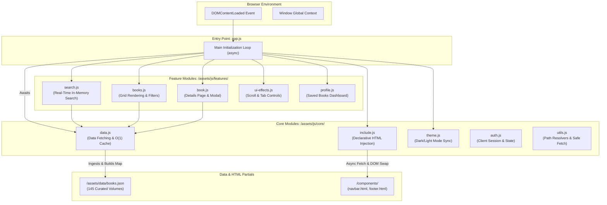

# 📐 System Architecture & Component Injection Engine

This document details the zero-dependency browser execution model, native ES6 module architecture, and the custom client-side declarative HTML injection engine powering the **Classical E-Library**.

---

## 1. Native ES6 Module Execution Model

Traditional single-page applications (SPAs) rely on heavy bundlers (Webpack, Vite, Rollup) and thousands of transitive `node_modules` dependencies to achieve component modularity. 

Classical E-Library adopts an **unbundled architectural philosophy**:
* Executed directly by the browser using native `<script type="module" src="assets/js/app.js">`.
* Zero compilation step, zero source map overhead, and zero build tool fragility.
* Complete tree-shaking and module isolation enforced naturally by browser scope.



---

## 2. Declarative HTML Component Injection (`core/include.js`)

To eliminate code duplication across multi-page views (`index.html`, `pages/books.html`, `pages/categories.html`) without a backend server or preprocessor, the platform uses a client-side declarative inclusion engine.

### Declarative Syntax
Any HTML element can request an external template snippet by declaring the `data-include` attribute:

```html
<!-- Reusable Navigation Bar -->
<div data-include="components/navbar.html"></div>

<!-- Reusable Footer -->
<div data-include="components/footer.html"></div>
```

### Dynamic Path Normalization
A critical challenge in static multi-page applications is that root pages (`index.html`) require paths like `assets/css/...`, whereas nested pages (`pages/books.html`) require `../assets/css/...`.

The engine dynamically normalizes every internal `href` and `src` attribute upon injection using regex path recalculation:

```javascript
// core/include.js - Dynamic Path Depth Calculation
function getRootPrefix() {
    const depth = window.location.pathname.split('/').filter(Boolean).length;
    // Calculates nesting relative to site root
    return depth > 1 ? '../'.repeat(depth - 1) : '';
}

function adjustPaths(html, prefix) {
    if (!prefix) return html;
    // Automatically offsets relative asset links inside injected partials
    return html.replace(/(href|src)=["'](?!http|\/\/|#|data:)([^"']+)["']/g, 
        (match, attr, path) => `${attr}="${prefix}${path}"`
    );
}
```

### Recursive Ingestion & Custom Event Lifecycle
1. The engine scans the DOM for all `[data-include]` nodes.
2. It fetches all requested templates in parallel using `Promise.all()`.
3. It runs `adjustPaths()`, replaces the placeholder node with the fetched DOM fragment, and scans for any nested `data-include` elements recursively.
4. Once all inclusions resolve, it dispatches a custom lifecycle event:
   ```javascript
   document.dispatchEvent(new CustomEvent('componentsLoaded'));
   ```
   Downstream feature modules (such as navigation active states and theme toggle listeners) subscribe to this event to ensure elements exist before binding event listeners.
