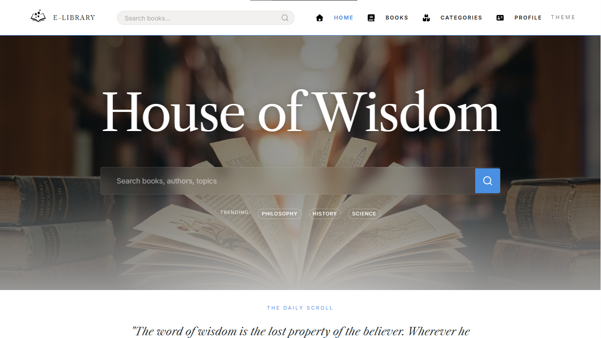
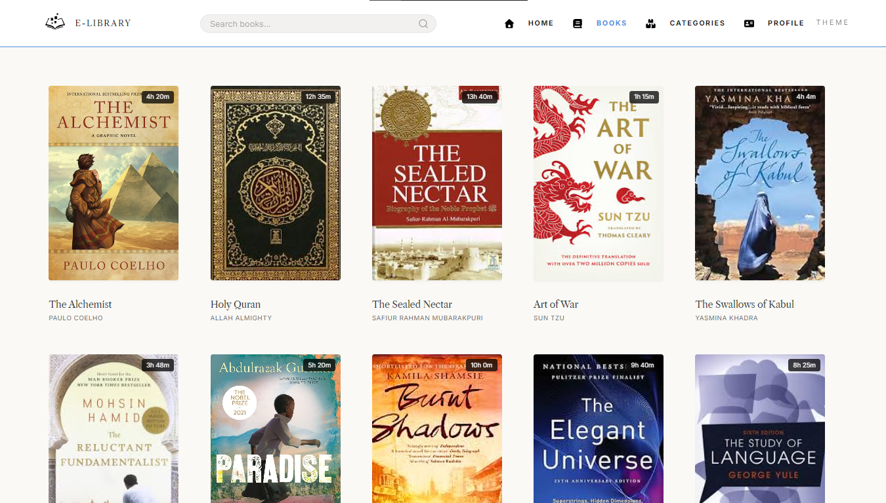
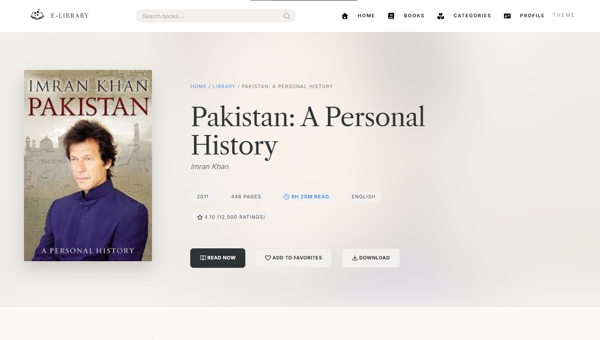

# 🎨 Design System, Theming & UI Mechanics

This document details the modular CSS token architecture, persistent dark/light theme synchronization, progressive skeleton loaders, and interactive modal mechanics of the **Classical E-Library**.

---

## 1. Modular Stylesheet Architecture

The styling system completely avoids preprocessors (SASS, LESS) or atomic utilities (Tailwind), maintaining high maintainability through clean, layered separation:

```text
assets/css/
├── base/                   # Foundational rules & variables
│   ├── reset.css           # Modern box-sizing & margin reset
│   ├── variables.css       # Design tokens (colors, spacing, elevations)
│   └── typography.css      # Type scale, font families, and line-heights
├── components/             # Reusable UI element rules
│   ├── book-card.css       # Catalog card grid item styles & hover states
│   ├── buttons.css         # Button variants (primary, ghost, pill)
│   ├── hero.css            # Landing page editorial hero layout
│   ├── modal.css           # Quick Peek modal dialog overlay
│   ├── navbar.css          # Sticky top navigation bar with active pills
│   └── footer.css          # Minimalist archival footer
└── pages/                  # Page-specific layout rules
    ├── home.css            # Featured showcase & ingress grids
    ├── books.css           # Filter rail & catalog grid
    ├── book-details.css    # Full bibliographic reader folio
    ├── categories.css      # Thematic taxonomy card matrix
    ├── profile.css         # Saved books & reading queue
    └── about.css           # Project genesis & institutional documentation
```

---

## 2. Persistent Theme Synchronization (`core/theme.js`)

Theme management operates entirely via CSS root custom properties (`var(--bg-primary)`, `var(--text-primary)`):

```javascript
// core/theme.js
const THEME_KEY = 'elib_theme';

export function initTheme() {
    // 1. Check explicit user preference from localStorage
    const savedTheme = localStorage.getItem(THEME_KEY);
    
    // 2. Fall back to hardware OS preference
    const systemPrefersDark = window.matchMedia('(prefers-color-scheme: dark)').matches;
    
    const activeTheme = savedTheme || (systemPrefersDark ? 'dark' : 'light');
    setTheme(activeTheme);
}

export function toggleTheme() {
    const currentTheme = document.documentElement.getAttribute('data-theme');
    const newTheme = currentTheme === 'dark' ? 'light' : 'dark';
    setTheme(newTheme);
}

function setTheme(theme) {
    document.documentElement.setAttribute('data-theme', theme);
    localStorage.setItem(THEME_KEY, theme);
}
```

By toggling the `data-theme` attribute on `<html>`, the browser switches palette variables instantaneously across all pages without layout reflow.

---

## 3. Progressive Skeleton Screens (Zero Layout Shift)

To achieve a 99/100 Lighthouse performance rating and eliminate Cumulative Layout Shift (CLS), the catalog renders animated skeleton placeholders before data resolution completes:

```javascript
// features/books.js
export function renderSkeletons(container, count = 12) {
    container.innerHTML = Array.from({ length: count }, () => `
        <div class="book-card skeleton-card">
            <div class="skeleton-image skeleton-pulse"></div>
            <div class="skeleton-text skeleton-pulse" style="width: 80%;"></div>
            <div class="skeleton-text skeleton-pulse" style="width: 50%;"></div>
        </div>
    `).join('');
}
```

Once `booksMap` resolves, the DOM swaps skeleton elements for real book cards without disturbing the user's viewport.

---

## 4. "Quick Peek" Modal Dialogs (`features/book.js`)

Readers can preview book summaries, star ratings, and publication metadata directly from the main catalog without navigating away or losing their filter state.

### Mechanics:
1. Clicking the "Quick Peek" icon on any card reads `data-id` and queries `getBookById(id)` in $O(1)$ time.
2. The modal markup is injected, the backdrop blur is activated, and keyboard navigation (`Escape` to close) is bound.
3. If the reader chooses to read further, the modal seamlessly transitions to the full reading folio (`pages/book-details.html?id=...`).

---

## 5. UI Showcase Plates

High-resolution visual captures of the production interface are preserved in [`assets/img/ui/demo/`](../assets/img/ui/demo/):

### 1. Home Showcase (`home-screen.png`)


### 2. Catalog Grid & Filter Rail (`book-area.png`)


### 3. Bibliographic Details Folio (`book-details.png`)

